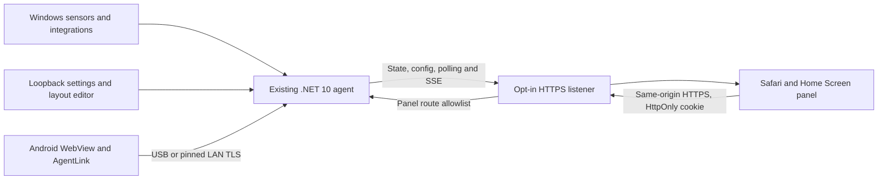

# PhoneBox PWA architecture

Base commit `c76212555bf84994e220300094ccf8bcb1310954`. Upstream PhoneBox remains MIT-licensed. This is an unofficial fork extension.

The Android WebView intercepts `/agent/*` and uses USB or the existing Android LAN listener with pinning and a bearer key.
The PWA starts the exact embedded `assets/www` panel on a separate HTTPS listener. Its entry module attaches EventSource to the same stream consumer the Android bridge uses. Both transports use the matching state/config endpoints and existing widget authorization, layout, theme, renderer, controls and replay logic. The agent's original monitors obtain samples and control hardware, media or integrations. The browser does not source PC metrics itself.

## Trust and access

- Configure a dedicated DNS hostname, specific IPv4 address and distinct port. Kestrel loads a matching certificate from the user's Windows store or a PFX with its intermediates. Safari verifies the chain and hostname. The browser does not receive the Android LAN bearer key.
- The local setup page mints a 128-bit random, five-minute, single-use pairing code. The QR link carries it in a URL fragment. The browser removes that fragment and sends the code in a JSON POST over HTTPS.
- Each paired browser keeps a host-only `Secure; HttpOnly; SameSite=Strict` cookie. The agent saves only SHA-256 digests of 256-bit session tokens, with a 90-day expiry. Re-pairing with a valid browser cookie retains its device ID and rotates the token. Revocation persists across restarts and cancels active streams.
- The server validates Host and Origin and rejects foreign Fetch Metadata. API requests use a custom panel header. The two exceptions are the authenticated GET event stream and passive image GETs with image Fetch Destination. POSTs require an exact Origin and panel header. The PWA listener advertises no CORS access.
- The PWA reuses the Android panel allowlist with further restrictions. The loopback editor, full settings, installer, webhook writes, Android pairing and battery reporting remain on their existing surfaces. A paired browser can invoke existing configured panel actions. Pair only devices that should have that authority.
- Custom HTML stays in the existing opaque-origin sandbox. PC action execution remains in existing handlers. Response headers deny framing and base/object injection on the PWA. The shared panel keeps its original inline bootstrap and supports sandboxed inline custom widget code.
- The service worker precaches only embedded public shell assets using credentials-omitted requests. API URLs, photos, session operations and event streams stay out of Cache Storage. The panel retains its existing public-layout local storage so it can render the last layout when offline.

## Lifecycle

The browser pauses its EventSource while hidden, starts it again on foreground, and keeps existing polling and event replay when the stream stalls. The panel signals disconnection and can show its cached layout without fabricating sensor data. A new service-worker build installs a complete versioned shell and activates when prior clients exit. Page choice and Wake Lock preference are local. Device-specific layout assignment stays in the agent's Phones settings.
